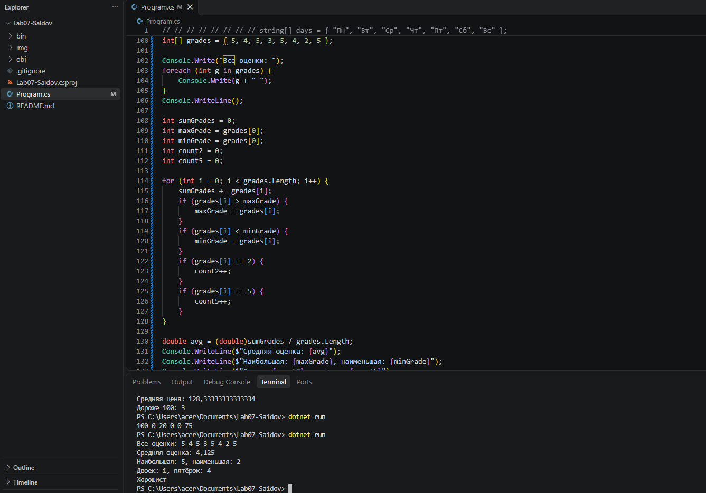
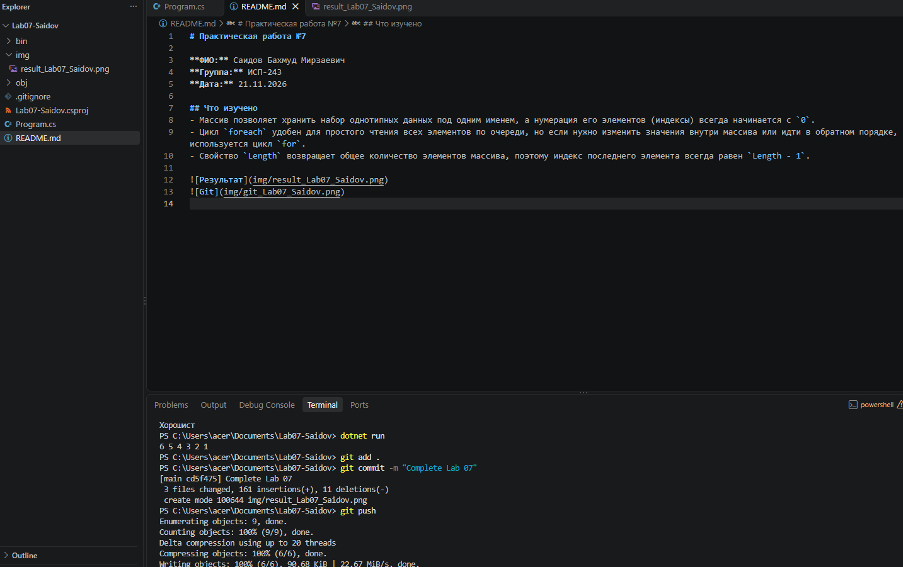

# Практическая работа №7

**ФИО:** Саидов Бахмуд Мирзаевич
**Группа:** ИСП-243
**Дата:** 23.11.2026

## Что изучено
- Массив позволяет хранить набор однотипных данных под одним именем, а нумерация его элементов (индексы) всегда начинается с `0`.
- Цикл `foreach` удобен для простого чтения всех элементов по очереди, но если нужно изменить значения внутри массива или идти в обратном порядке, используется цикл `for`.
- Свойство `Length` возвращает общее количество элементов массива, поэтому индекс последнего элемента всегда равен `Length - 1`.

